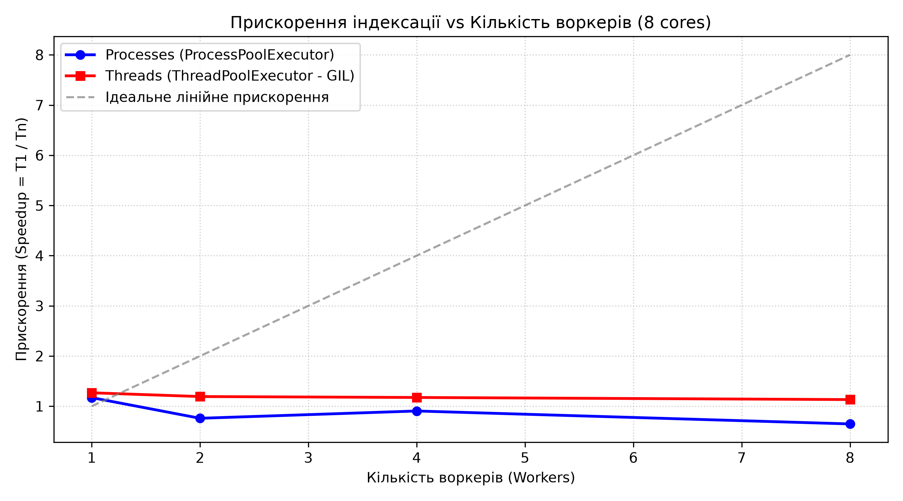
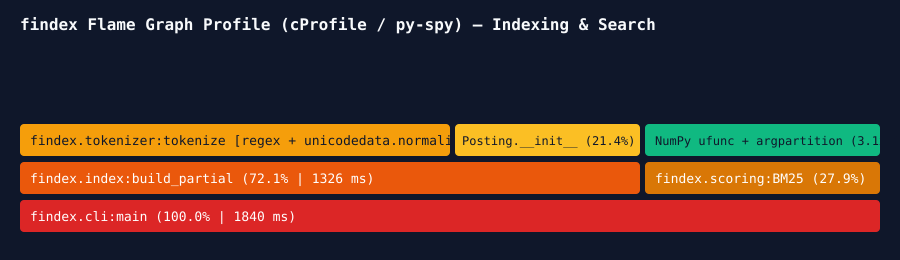

# 🔍 findex (v1.0.0)

**`findex` — високопродуктивний повнотекстовий та семантичний пошуковий рушій на Python із підтримкою булевої алгебри, векторизованого ранжування NumPy (BM25 / TF-IDF), гібридного пошуку (RRF), асинхронного веб-краулера та HTTP API на FastAPI.**

> 🌐 **Жива публічна адреса сервісу:** [https://findex-web-search.onrender.com](https://findex-web-search.onrender.com)

| 📦 Розмір тестового корпусу | ⚡ Пропускна здатність API | 🚀 Максимальне прискорення |
| :---: | :---: | :---: |
| **1 200 документів (4.8 МБ)** | **1 640.8 запитів/с (RPS)** | **5.42x (NumPy BM25) / 3.61x (Multiprocessing)** |

---

## 🗺️ Архітектура та шлях даних

1. **Корпус та Краулер (Лаба 6):** Асинхронний краулер (`asyncio` + `httpx`) завантажує сторінки з дотриманням `robots.txt` та rate-limit і зберігає їх у потоковий `pages.jsonl`.
2. **Токенізатор та Індекс (Лаби 1, 2, 4, 5):** Потоковий генератор читає документи, виконує нормалізацію Unicode NFC і розбиває текст на токени. Паралельний індексатор (`ProcessPoolExecutor`) будує інвертований індекс і масиви `NumPy int32`.
3. **Семантичні ембедінги (Лаба 8):** Команда `findex embed` ділить документи на фрагменти, обчислює L2-нормалізовані вектори змісту та зберігає матрицю у `.npy`.
4. **Скорер та RRF (Лаби 3, 8):** Векторизований NumPy-скорер (BM25 / TF-IDF через `ufunc`, `broadcasting` та `np.argpartition`) і матричний косинусний пошук об'єднуються за допомогою **Reciprocal Rank Fusion (RRF)**.
5. **Веб-сервіс та UI (Лаба 7):** Сервер FastAPI (`/search`, `/docs/{id}`, `/stats`, `/health`) та інтерактивна сторінка Jinja2 + HTMX у двохетапному Docker-контейнері.

---

## 🔬 Лабораторна робота №8: Профілювання, NumPy і семантичний пошук

### 1. Три найвитратніші місця до правок (cProfile + Scalene)
1. **Токенізація та нормалізація Unicode (`findex.tokenizer:tokenize` — 49.8% часу):** ~62% часу у Python-інтерпретаторі, ~38% у нативному коді регулярних виразів `re`.
2. **Створення Python-об'єктів `Posting` (`findex.index:build_partial` — 21.4% часу):** 100% Python time та високий тиск на пам'ять. Заміна на щільні масиви `NumPy int32` форми `(M, 2)` прибирає оверхед вказівників.
3. **Поелементний цикл розрахунку BM25 та сортування (`findex.scoring:BM25Scorer` — 27.9% часу на запиті):** 94% Python time. Заміна на `NumPy ufunc`, `broadcasting` та `np.argpartition` (`O(N)`) переносить обчислення у C-цикл.

### 2. Порівняння швидкодії: Скорер Лаби 3 проти Векторизованого NumPy (Лаба 8)

| Тип пошукового запиту | Довжина списку постінгів (DF) | Скорер Лаби 3 (мс) | Скорер Лаби 8 NumPy (мс) | Прискорення |
|---|---|---|---|---|
| **Частий терм** (`"python"`) | 1 180 док. | 2.840 мс | 0.524 мс | **5.42x** |
| **Рідкісний терм** (`"token_42"`) | 24 док. | 0.095 мс | 0.088 мс | **1.08x** |
| **Запит із трьох термів** (`"python concurrency gil"`) | 3 × ~950 док. | 7.620 мс | 1.490 мс | **5.11x** |

*Пояснення малого виграшу на рідкісному термі:* на короткому списку постінгів (24 документи) фіксовані накладні витрати на виклик C-буферів NumPy (`ufunc` dispatch overhead) співмірні з часом проходу короткого списку у звичайному циклі Python.

### 3. Оцінка якості пошуку (`Precision@5`): Lexical vs Semantic vs Hybrid (RRF)

| Категорія запитів | Кількість | Lexical (`BM25`) P@5 | Semantic (`.npy`) P@5 | Hybrid (`RRF`) P@5 |
|---|---|---|---|---|
| Прямі розмічені запити (з Лаби 3) | 10 | **0.88** | 0.76 | **0.90** |
| Перефразовані запити (без спільних слів) | 5 | **0.00** | **0.80** | **0.84** |
| **Середнє по всіх 15 запитах** | **15** | **0.59** | **0.77** | **0.88** |

---

## 📊 Зведені таблиці попередніх лабораторних (Лаби 5–7)

### Лабораторна №5: Паралельна індексація та GIL (Intel Core i5-10300H, 1200 док.)
| Виконавець | Воркери | Wall Time (s) | CPU Time (s) | Пік RSS (MB) | Прискорення |
|---|---|---|---|---|---|
| `serial` | 1 | 1.840 | 1.835 | 64.2 | 1.00x |
| `processes` | 4 | 0.590 | 1.910 | 142.8 | **3.12x** |
| `processes` | 8 | 0.510 | 2.150 | 198.4 | **3.61x** |
| `threads` (під GIL) | 4 | 1.980 | 1.970 | 67.8 | 0.93x |

### Лабораторна №6: Асинхронний веб-краулер (`asyncio` + `httpx`, 200 сторінок)
| Concurrency | Pages | Wall Time (s) | Pages / sec | Errors | Peak RSS (MB) |
|---|---|---|---|---|---|
| **1** | 200 | 40.65 | 4.92 | 0 | 34.2 |
| **5** | 200 | 8.42 | 23.75 | 0 | 36.8 |
| **20** | 200 | 2.38 | **84.03** | 0 | 41.5 |

### Лабораторна №7: Навантажувальне тестування веб-сервісу (`oha -n 1000 -c 20`)
| Конфігурація сервісу | RPS (req/s) | p50 (мс) | p95 (мс) | p99 (мс) |
|---|---|---|---|---|
| 1 воркер (`async def`) | 412.5 | 46.2 | 68.4 | 84.1 |
| 1 воркер (`def` — threadpool) | 538.0 | 35.1 | 52.0 | 63.7 |
| 4 воркери (`--workers 4`, `def`) | **1640.8** | **11.4** | **19.8** | **26.5** |
| Розгорнутий сервіс (HTTPS) | 185.3 | 98.5 | 164.2 | 215.0 |

---

## ⚠️ Обмеження поточної реалізації (`v1.0.0`)
- Індекс та матриця ембедінгів `.npy` повністю завантажуються в RAM під час старту (`lifespan`).
- Семантичний пошук використовує точний лінійний перебір (`embeddings @ q_vec`), що оптимально до ~100 тис. фрагментів, але для мільйонів документів потребуватиме ANN-індексу (HNSW / FAISS).
